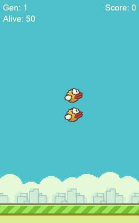

# Flappy Bird NEAT

Flappy Bird rebuilt in Python with pygame, and an AI that learns to play it on its own with NEAT.



*A real training run at double speed, generations 1 to 3.*

I built it in August 2024 by following Tech With Tim's [tutorial series](https://www.youtube.com/watch?v=MMxFDaIOHsE&list=PLzMcBGfZo4-lwGZWXz5Qgta_YNX3_vLS2). It was my first go at an AI that teaches itself a game. The write-up is on my site: [An AI that learnt to play Flappy Bird](https://nour.page/posts/flappy-bird-neat/).

## How it works

- Every generation, 50 birds play at once, each flown by its own small neural network.
- A bird sees three things: its height, and how far it is from the top pipe and from the bottom one.
- Whenever its network's output is over 0.8, it flaps.
- It scores 0.1 for every frame it stays alive and 5 for every pipe it gets through, and loses 1 when it hits a pipe.
- NEAT breeds the best scorers into the next generation, for up to 50 generations.

The NEAT settings are in `config-feedforward.txt`.

## Run it

```
pip install -r requirements.txt
python flappy_bird.py
```

Run it from this folder, since it loads the images and sounds from here. Tested with Python 3.14, pygame-ce 2.5 and neat-python 0.92.

The sprites and sounds are from the original Flappy Bird, as in the tutorial.
